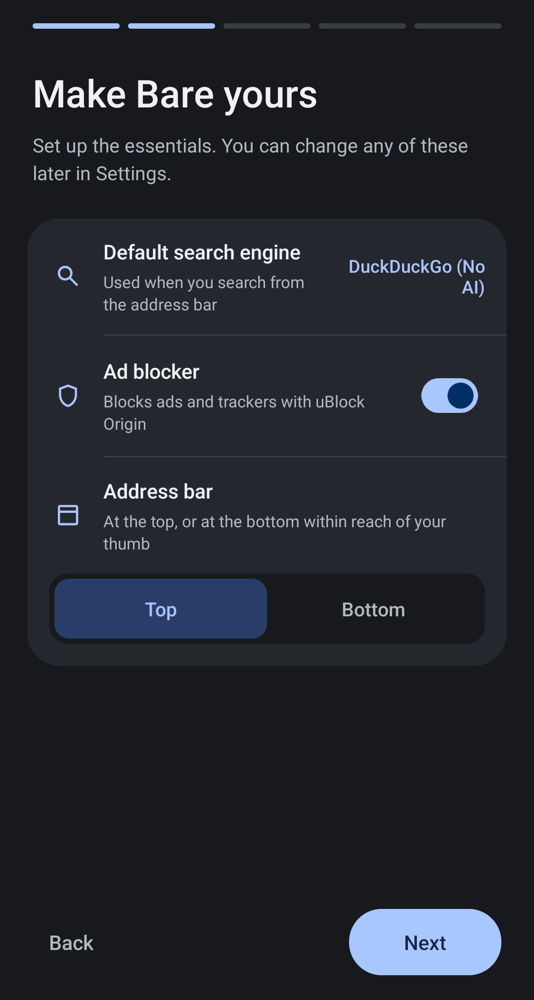

<div align="center">


# Bare Browser

**Shaped by the community**

**Extensions. Privacy. Freedom**

[barebrowser.org](https://barebrowser.org)

</div>

---

Bare is a de-Googled Chromium build for Android, designed to give you more privacy, control and
freedom on the web. It strips Google tracking, telemetry and AI integration while keeping
powerful features like browser extensions and uBlock Origin. Bare also adds background video
playback, the ability to save media from sites that normally block it, support for choosing your
preferred download manager, and much more.

It is a patch series rather than a fork: 164 patches against one pinned revision of **Chromium
Desktop Android**, so what this repository holds is exactly the difference between stock Chromium
and Bare, and nothing else.

Built and used on a Pixel 10 Pro XL. Not affiliated with Google or the Chromium project.

- **Base:** Chromium `156.0.8078.25` (commit `12282315`)
- **Target:** `is_desktop_android = true`, `target_cpu = "arm64"` and `"arm"`
- **Runs on:** Android 10 or later, on arm64 or 32-bit arm; there is no x86 build
- **Version:** `1.0.0`, versionCode `801000075` (arm64) / `801000070` (32-bit arm)
- **Size:** 164 patches, 19,250 insertions across 469 files

## What you get

- **Real browser extensions.** Bitwarden, Dark Reader, uBlock Origin: the desktop ones, on your
  phone. Pin the ones you use to the toolbar.
- **[uBlock Origin](https://github.com/gorhill/uBlock), already installed.** The full version,
  not Lite, because Bare keeps Manifest V2 working. Shipped exactly as its author publishes
  it. Remove it like anything else if you would rather not have it. Its page in Extensions says
  it is not from the Chrome Web Store, which is true: the store stopped carrying it.
- **Extensions from a file.** The Extensions page has Load unpacked, Load CRX for a packaged `.crx`
  you have downloaded, and Update, with no Developer mode switch in the way. Bare cannot check
  whether an extension is safe, so it says so once, in the dialog that adds one, instead of
  flagging extensions from outside the Chrome Web Store afterwards. Each extension's card has an
  Allow in Incognito switch, the same setting as the one on its details page. On a new profile
  uBlock Origin starts allowed in Incognito; every other extension starts off until you turn it
  on. Developer mode stays on underneath, so cards show IDs and background pages, and an
  extension loaded from a folder is never disabled for coming from outside a store. The risk
  sentence is skipped when a `.crx` updates an extension that is already installed, and a folder
  whose manifest key gives an installed extension's ID takes over that extension and its storage.
  An extension loaded from a folder is read from it again on later starts without asking. The
  dialog's sentence and button, the new buttons and their messages are in English only.
- **A short welcome.** Five pages for the search engine, the ad blocker, where the address bar
  sits, downloads, background audio, notifications, the default browser and updates. It comes
  back after each update, starting from what you already chose, so a new choice is asked about
  rather than made for you. Bare does not ask for notifications anywhere else: on Android 13 or
  later, skip that row and downloads show no notifications until you allow them on the welcome
  after the next update, in Android's settings, or when a site asks and you agree.
- **No telemetry, no AI, no sign-in prompts.** DuckDuckGo is the default from first launch. A
  few things still reach a server on their own, and each is named in
  [Network behaviour](#network-behaviour) rather than glossed over.
- **Save what a page is playing.** Long press a video or an audio player and Bare offers you the
  file, including on sites that stream in pieces and normally offer nothing at all.
- **Video keeps playing in the background.** Lock the phone or switch apps and the audio carries
  on, for sites that support it.
- **Your download manager, if you want one.** Hand downloads to 1DM or similar instead of the
  browser, or leave it off and keep them in Bare. The other app does not get your sign-in to the
  site, so a file that needs it may fail there.
- **Links open in the browser, not in apps.** A Reddit or YouTube result stays where you are.
  Phone numbers and email links still open the right app.
- **Video that behaves.** H.264 and AAC are included. Fullscreen follows your rotation lock
  instead of forcing landscape, and clears the camera cutout instead of sitting beside it.
- **Dark stays dark.** No white flash while a page loads on a dark theme. There is also an
  optional setting to have Bare darken light sites itself.
- **Add your own search engine.** Chromium ships the add-engine screen on Android but leaves it
  switched off. It is on here, under Settings, Search engine, Manage search engines.

## Screenshots

| | |
| --- | --- |
|  |  |
| The welcome screen, where the choices are made | A new tab, with no logo to fetch |
|  |  |
| uBlock Origin, the full version | Extensions in the toolbar |
|  |  |
| Saving an image | Saving video a site does not offer |
|  |  |
| Picking a stream to keep | The address bar |
|  |  |
| Arranging the toolbar | A second action on a hold |
|  |  |
| A sideways drag along the bar | Whether links leave for an app |
|  |  |
| Themes, including AMOLED | Choosing what Exit deletes |
|  |  |
| Grid or list | Tabs as a list |

## Support the project

Bare is one person and one phone. There is no company behind it, nothing in the browser sells
you anything, and there is nothing to upsell you to later, which is rather the point of it.

If it is useful to you, you can buy me a coffee. Entirely optional. It buys build hours and a
second device to test on, and it changes nothing about the browser either way.

<a href="https://buymeacoffee.com/sheshtawy">
  
</a>

## Why

Chromium's Desktop Android build supports real browser extensions, which mobile Chrome does
not. That makes it a genuinely better browser to live in, but it still ships Google's AI
stack, phones home on a schedule, and hands your links to other apps. Bare removes that as a
patch series rather than a fork, so every change stays readable and reviewable, and
[Network behaviour](#network-behaviour) lists what still reaches a server.

## What the patches do

A hundred and sixty patches against one pinned Chromium revision: crash fixes, the
extensions toolbar on phone layouts, Google callbacks and AI surfaces removed, and the
features Bare adds on top.

**[The full list, patch by patch, is in docs/patches.md](docs/patches.md)** along with what is
removed by build flag instead of by patch, and what is deliberately kept.

## Network behaviour

Measured on a Pixel 3 running Android 12, by watching the sockets opened under Bare's own uid
and recording the browser's own network log. For 1.0.0 that covered a wiped profile from first
launch through the welcome screen, a network change and several minutes idle, then several
sites, a page that fails to resolve, and the Languages and Search engine settings. What follows
is what was actually observed, not what was intended.

**Chromium's component updater contacts `update.googleapis.com`**, from the first start onwards,
and fetches the components it needs as signed packages over plain HTTP from Google's download
host `edgedl.me.gvt1.com`. It is kept deliberately. These are the components registered in
1.0.0, as `chrome://components` lists them:

| Component | Why it stays |
| --- | --- |
| CRLSet | certificate revocation |
| PKI Metadata | Certificate Transparency |
| Certificate Error Assistant | quality of the TLS interstitial |
| File Type Policies | download danger classification |
| Origin Trials | web compatibility |
| Safety Tips, Crowd Deny | lookalike-domain and abusive-notification lists, applied locally |
| Captcha Providers | left registered: its purpose is not clear enough in the tree to remove it confidently |

Registration tells Google an install exists, along with a component id, a version, an install
date and a cohort. Twelve other components were dropped in patch 0085 for buying nothing here:
the Privacy Sandbox set, Google's omnibox suggestion model, the optimization-hints feed, shopping
and checkout heuristics, on-device AI history strings, and two Safe Browsing lists that nothing
can consult. Actor Safety Lists, the site lists of the Gemini agent this build keeps off, was
dropped in 0188. There is no Widevine component on Android; protected video goes through the
system's own DRM, below.

**Widevine provisioning contacts `www.googleapis.com`.** About a minute after startup on a fresh
profile, Chromium has Android's MediaDrm provision two spare Widevine origin identifiers in
advance, so that protected video can start without waiting, and the provisioning request goes to
`www.googleapis.com/certificateprovisioning`. If there is no connection then, it tries again when
the network comes back. It happens whether or not any site ever plays protected video. By the
code, a later start repeats it only once sites have used up the spare identifiers. This is Chromium's default (`kMediaDrmPreprovisioningAtStartup`), and Bare leaves it
as it is.

**On the first run of a fresh profile, most of the rest is uBlock Origin** fetching the filter
lists it ships enabled, from the list maintainers and their CDNs rather than from Google:
`pgl.yoyo.org`, `ublockorigin.github.io`, `ublockorigin.pages.dev`, `malware-filter.pages.dev`,
`cdn.jsdelivr.net` and `publicsuffix.org`. That happens once and then on the extension's own
schedule. uBlock Origin is installed and fetching these while the welcome screen is still asking
whether you want an ad blocker; turning the switch off removes it, with its settings.

**uBlock Origin updates itself from its author.** Its manifest points Chromium's extension updater
at `cdn.jsdelivr.net` (`gh/gorhill/uBlock@master/dist/chromium/update.xml`), which is checked
about every five hours. That request carries what Chromium's extension updater always sends: the
extension's id and version, the browser's version, the operating system and architecture, the
interface language and the User-Agent. A newer release downloads from `github.com`, served from
`release-assets.githubusercontent.com`. Earlier releases shipped the Chrome Web Store copy, which
checked `clients2.google.com` instead.

**The update check contacts GitHub**, and only after the welcome screen has been completed and an
update preference stored. It is at most one request a day, to a public release feed. It sends two
headers, `User-Agent: Bare/<version>` and `Accept: application/atom+xml`, so the request does say
which version is asking. What it carries beyond that is nothing that identifies you or the phone:
no cookies, no installation identifier, no device model, no Android build. The platform default
User-Agent would have carried the model and the build, so it is replaced. Choosing manual means
nothing leaves the device until the Check for updates row is tapped.

**If you make Google your search engine**, more of Chromium's Google-only behaviour switches on
with it. Focusing the address bar asks `www.google.com/complete/search` for suggestions before you
type anything. By the code, Chromium also preconnects to `www.google.com` from time to time,
prefetches search results, prerenders `www.google.com/search/warmup.html` on focus (`kPrewarm`),
asks `www.google.com/async/folae` whether AI Mode is available, and sends a word you tap on a
page to `www.google.com/s` for Touch to Search. With DuckDuckGo or any other engine none of this
happens. With Google, the new tab page shows the plain Google logo; with DuckDuckGo it shows
DuckDuckGo's, from `staticcdn.duckduckgo.com`.

**Request desktop site sends a Chrome OS User-Agent** (`X11; CrOS x86_64 14541.0.0`), as
Chromium 156 does, where earlier releases said desktop Linux. Its client hints do not match: the
architecture hint says arm, and the bitness hint says 64 even on the 32-bit build. A site can
notice the difference.

**The Chrome Web Store gets that desktop User-Agent at the phone's width.** With a phone
User-Agent the store swaps "Add to Chrome" for "Add to Desktop", which sends the extension to a
signed-in desktop Chrome instead of installing it. So `chromewebstore.google.com` is asked for its
desktop pages and keeps its own phone layout. Earlier releases did this with a stored desktop-site
setting that covered every `google.com` site; 1.0.1 removes that setting once, on first launch.

**Developer options can change the User-Agent.** Default sends the strings described here. The
other choices are Chrome on five platforms, Edge, Firefox and Safari, or a typed string, and they
apply after a restart. Chrome and Edge send client hints that match; Firefox, Safari and a typed
string send none, as those browsers don't. While one is chosen, Request desktop site is greyed
out. Sites can still tell this is Bare from `navigator.platform` and similar signals.

**Some things reach Google only when you do them:**

- **Settings, Help & feedback** opens Google's Chrome help centre at `support.google.com`, after
  checking connectivity against `clients4.google.com` and `www.google.com`.
- **A site you allow to send push notifications** registers with Google's push service, through
  Google Play services, as web push does in Chrome. The subscription it gets back names
  `google.com` as its endpoint. The messages themselves are never delivered: patch 0007 removes
  the receiver they would arrive through.
- **A Google or YouTube page that publishes cross-origin speculation rules** can have Chromium
  prefetch the pages it names through Google's private prefetch proxy, `tunnel.googlezip.net`,
  after checking it can reach `dns-tunnel-check.googlezip.net` and `tls-tunnel-check.googlezip.net`.
  This depends on the page you are on, not on your search engine.
- **A payment form that asks for a shipping address** loads address formats from
  `chromium-i18n.appspot.com` when you edit the address.
- **chrome://metrics-internals** can fetch a variations seed from Google if you open it and ask
  for one.
- **An extension installed from the Chrome Web Store** checks for updates at
  `clients2.google.com`, about every five hours, like any other copy of Chromium. Chromium's daily
  request for Web Store metadata about installed extensions is not made: it needs an API key this
  build does not have.
- **A custom home page** may get its icon from Google's favicon server, `t0.gstatic.com`.

The proxy, the payment form, metrics-internals, the home page icon and Touch to Search above are
read from the code and were not captured.

Extension update checks that do not go to the Chrome Web Store carry any cookies the browser
holds for that host, as upstream Chromium sends them; for uBlock Origin that is `cdn.jsdelivr.net`.
The downloads that follow go without cookies, unless the server refuses one with 401 or 403 and
Chromium tries again with them.

**What no longer happens**, each checked with a capture of the browser's network log:

- No Firebase or InstanceID registration on its own. A fresh profile previously fetched two FCM
  tokens for Chromium's cloud-policy invalidation projects and kept them in shared preferences as
  durable identifiers. Patches 0081 and 0086 removed both consumers; the token files are no longer
  created at all. A site you allow to send push notifications still registers, as above.
- No lookup against `accounts.google.com`, from the omnibox or at startup. Typing in the address
  bar used to reach GAIA ListAccounts to decide whether to personalise suggestions. Separately, a
  fresh profile used to POST to ListAccounts about a tenth of a second into every cold start,
  before the welcome screen had been answered. Neither the omnibox nor the account reconcilor was
  behind the startup one: two services asked for the cookie jar while the profile was still being
  built, both only to report metrics, and reading the cookie jar fetched it from Google whenever
  the cached answer was stale. Patch 0093 stops the read from reaching the network, so the answer
  now comes from the cache. Visiting Google sites and signing in to them is unaffected.
- No Safe Browsing traffic. There was never any: see below.
- No lookup of `google.com` at Google Public DNS when a site cannot be found. Chromium resolved
  it against `8.8.8.8` over plain UDP to diagnose the failure, outside the user's Secure DNS
  setting; 0180 turns that probe off, and the error page still says the address could not be
  found.
- No request to `translate.googleapis.com` from Settings, Languages, which fetched the list of
  languages Google can translate; 0181 keeps the list built into Chromium.
- No icons for search engines from Google's favicon server (`t0.gstatic.com`), which Settings,
  Search engine asked for any engine without a built-in icon; 0183 uses the icon stored from
  visiting the site, or a placeholder.
- No Discover feed and no doodle on the new tab page with Google as the engine. Each new tab
  asked `discover-pa.googleapis.com` for a feed it could not get and `www.google.com/async/ddljson`
  for the day's doodle; 0193 turns Discover off and 0194 keeps the built-in logo.
- No hint requests to `optimizationguide-pa.googleapis.com`, which some features sent with the
  hosts of the pages involved even though the request could only be refused; 0187 stops them
  without an API key.
- No translate ranker model from `www.gstatic.com`. Every tab's translate client could download
  it on a fresh profile, for a decision translation without an API key never asks for; 0199 gives
  it no URL without a key. A capture from the moment the browser starts showed no request to
  `www.gstatic.com`.
- No translations or CSS documentation for Developer tools from
  `chrome-devtools-frontend.appspot.com`, which the frontend fetched when offered the browser's
  language; 0185 keeps it to the English files built in.

The 1.0.0 capture reached none of the hosts in this list.

Chromium 156 also started sending HEAD requests to three random hostnames after launch and after
every network change, to detect DNS interception. Patch 0170 turns that check off.

Traffic from Android itself and from Google Play Services is separate from all of this and is not
affected by anything Bare does.

**Safe Browsing does not work in this build, and no longer claims to.** Chromium Android performs
lookups through a handler that Google injects in its own build and that no public build has. The
settings, the Safety Hub module and the promotional cards all described protection that never
ran, so patch 0080 removed them. Bare shows no phishing or malware interstitial. Treat unknown
links with the caution you would give a browser with no such feature, because that is what this
is.

## Requirements

- Docker, with at least **32 GB** allocated to the VM. At 16 GB a full build is
  reliably OOM-killed partway through.
- ~100 GB free disk. The Chromium checkout alone is ~50 GB.
- An arm64 Android device for testing.

Builds run in an x86-64 Ubuntu 22.04 container. On Apple Silicon this means Rosetta
emulation, and a full build takes hours.

## Build it yourself

Everything runs in the container. The Chromium checkout stays in its volume, because building
from a macOS bind mount is slow and unreliable; only small files cross to the host, through
`exchange/`, which is the one directory shared with the container.

**1. Start the container.**

```bash
./builder.sh build
./builder.sh start
```

**2. Put what the build needs where the container can see it.**

```bash
cp -R patches exchange/
cp third_party/ublock_origin/uBlockOrigin-1.75.0.crx exchange/
tools/version.py gn arm64 > exchange/version-args.gn
```

**3. Fetch Chromium.** Inside the container (`./builder.sh shell`). depot_tools is on the PATH
but not installed, so clone it first. This part is Chromium's own procedure rather than
anything specific to Bare. See the upstream [Android build
instructions](https://chromium.googlesource.com/chromium/src/+/main/docs/android_build_instructions.md)
if a step needs explaining. Expect hours and about 50 GB.

```bash
git clone https://chromium.googlesource.com/chromium/tools/depot_tools.git ~/depot_tools
mkdir -p /work/chromium && cd /work/chromium
fetch --nohooks android
cd src
git checkout 1228231501697ff7a4a0150ea8ae6df37bb99331
gclient sync -D --force --reset
./build/install-build-deps.sh --android
```

**4. Apply the series, and drop in the extension.** uBlock Origin is kept out of the patches
because a 4 MB signed binary as base64 would be unreviewable, so it is copied in separately.
Without it the build fails at packaging.

```bash
git am /exchange/patches/*.patch
mkdir -p chrome/browser/resources/bare
cp /exchange/uBlockOrigin-1.75.0.crx chrome/browser/resources/bare/ublock_origin.crx
```

**5. Configure.** This is the complete configuration the published release was built with,
nothing omitted:

```gn
target_os = "android"
target_cpu = "arm64"
is_desktop_android = true
is_official_build = true
is_debug = false
is_java_debug = false
is_component_build = false
dcheck_always_on = false
android_static_analysis = "off"
symbol_level = 0
blink_symbol_level = 0
v8_symbol_level = 0
use_remoteexec = false
use_reclient = false

proprietary_codecs = true
ffmpeg_branding = "Chrome"

use_mlkit_for_aicore = false
enable_glic_internal_resources = false
enable_reporting = false
enable_service_discovery = false
enable_mdns = false
enable_arcore = false
enable_cardboard = false
enable_openxr = false

disable_fieldtrial_testing_config = true

chrome_public_manifest_package = "org.barebrowser"
android_override_version_code = "801000075"
android_override_version_name = "1.0.0"
```

The last two lines are what `tools/version.py gn arm64` emits, and they matter: they are written into
the manifest, so a build without them will not match the release.

`disable_fieldtrial_testing_config` matters as much. Without it the build follows
`testing/variations/fieldtrial_testing_config.json` instead of the code defaults, and several
patches here are inert. [docs/build-constraints.md](docs/build-constraints.md) has the four
behaviours that came from that file rather than from the code.

The 32-bit build differs in exactly three lines: `target_cpu = "arm"`, the version code
`801000070` that `tools/version.py gn arm` emits, and `clang_use_default_sample_profile = false`,
which stops GN demanding an AFDO profile this checkout never syncs.

```bash
mkdir -p out/Bare
$EDITOR out/Bare/args.gn          # paste the block above
gn gen out/Bare
autoninja -C out/Bare chrome_public_apk
```

**6. Compare.** Your APK will not be byte-identical to the published one, because that one
carries a signature only its key can produce. Everything else should match:

```bash
tools/apk-content-hash.py out/Bare/apks/ChromePublic.apk Bare-1.0.0.apk
```

See [BUILDING.md](BUILDING.md) for the rest of the workflow, including versioning and how
releases are signed.

## Verifying a build

Three questions, and they have different answers.

**Is this the file that was published?** Compare its SHA-256 against the one on the release page.
That catches a truncated or tampered download and nothing else: the hash is published by the same
person as the file, so on its own it proves nothing about where the file came from.

**Is it genuinely Bare?** Check who signed it. Nothing signed by any other key is Bare.

```bash
apksigner verify --print-certs Bare-1.0.0.apk
```

    SHA-256  ae:2a:0e:7f:b7:a1:32:ec:51:7d:26:a8:e7:c8:3d:27
             5e:83:74:7b:0a:77:7d:4a:42:22:5b:1d:34:32:71:a0
    subject  CN=Bare Browser, O=Bare Browser, OU=Release
    key      RSA 4096

**Releases before `v1.0.0-alpha.1` were signed with Chromium's debug key**, which is checked into
Chromium's tree and therefore public. Anyone can build an APK that installs as an update over one
of those. If you are running a Chromium Extend build, uninstall it rather than updating; a Bare
release cannot replace it in place anyway, because the signing identity deliberately changed.

**Can you rebuild it yourself?** Yes, and that is the only one of the three that proves where a
binary came from. The signature is deliberately not reproducible, since nobody but the key holder
can produce it, but everything else is. Follow [Build it yourself](#build-it-yourself) exactly,
including the version arguments, then compare:

```bash
tools/apk-content-hash.py out/Bare/apks/ChromePublic.apk Bare-1.0.0.apk
```

It hashes every entry except the signature, so two builds of the same source agree whoever signed
them. [What has been measured, and what has not](docs/reproducibility.md).

## Not done yet

Each is described in [docs/build-constraints.md](docs/build-constraints.md):

- Safe Browsing, blocked by one un-gated call site in the Android JNI bridge
- Google XR SDKs (ARCore, Cardboard, VrCore, OpenXR), blocked by three omnibox call sites;
  the flags are coupled in both directions and there is no GN-only configuration that works
- `build_with_model_execution`, `enable_supervised_users`, `enable_offline_pages`, each
  blocked by a single GN `assert()`
- ARCore, Cardboard and Daydream manifest entries persist from library manifests, though their
  code is gone

### Already inert, no work needed

Worth knowing before anyone patches them: a public (non-Chrome-branded) Chromium build already
sends no usage metrics, no URL-keyed metrics and no crash reports, because upstream withholds
those endpoints from forks. Translate is likewise disabled without a Google API key; 0181 and
0199 stop the two requests it still made, for its language list and its ranker model. Details and
evidence are in [docs/build-constraints.md](docs/build-constraints.md).

## Repository layout

```
patches/                 the patch series, applied in order
docker/                  container image definition
docker-compose.yml       build environment
builder.sh               container wrapper
assets/                  logo, screenshots and the support button used in this README
tools/                   version numbers, release signing, build comparison
VERSION                  Bare's version, independent of Chromium's
third_party/             uBlock Origin as shipped, with its provenance
docs/patches.md          what every patch does
docs/reproducibility.md  what rebuilding has and has not proven
docs/build-constraints.md  what a build flag cannot switch off, and what upstream already did
```

The Chromium checkout, build output, and APKs are not tracked: they live in a Docker volume
and would be far past GitHub's file size limits.

## Credits

Bare is a thin layer on other people's work.

**[Chromium](https://www.chromium.org/)** is the browser. The patches modify its source and are
therefore subject to its **BSD-3-Clause** licence. See the
[Chromium LICENSE](https://chromium.googlesource.com/chromium/src/+/main/LICENSE).

**[uBlock Origin](https://github.com/gorhill/uBlock)**, by Raymond Hill and contributors, is
licensed under the **GPL-3.0** and ships inside the apk. It is the extension exactly as its
author publishes it: downloaded from his release on GitHub, unmodified, not repackaged and not
re-signed, so it keeps his signature and the extension id that comes with his key. The licence text travels
inside it, the corresponding source is the upstream release, and provenance and checksum are in
[third_party/ublock_origin](third_party/ublock_origin). Bundling it beside a BSD project is mere
aggregation; uBlock Origin remains under the GPL and Bare's licence does not touch it. Bare is
not affiliated with or endorsed by the uBlock Origin project.

**[Titanium](https://github.com/jqssun/android-titanium-browser)**, by jqssun, is built from the
same `is_desktop_android` target and ships to phones, which makes it a working reference for the
places Chromium still treats that target as a desktop. Patch 0078 came out of reading its
`patch.sh`, which showed which two files gate the omnibox verbatim match. The edits here came out
different: Titanium switches both off, Bare keeps a device check where the code allows one.

**[Cromite](https://github.com/uazo/cromite)** and
**[ungoogled-chromium](https://github.com/ungoogled-software/ungoogled-chromium)** were used as
reference throughout. Finding every call site that reaches a Google service is the hard part of
this work, and both projects had already found many of them. A couple of the patches here do the
same job as theirs.

`assets/logo_bare_blend.svg` and `assets/logo_bare_blend.png` are the Bare mark and belong to
this project.

Chromium is a trademark of Google LLC. Bare is unaffiliated with Google or the Chromium project,
and is not Chromium.
