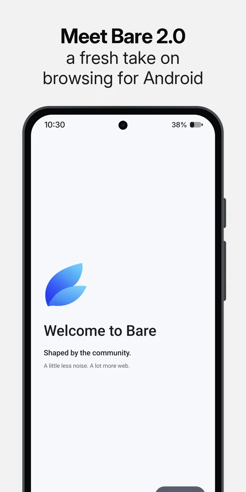
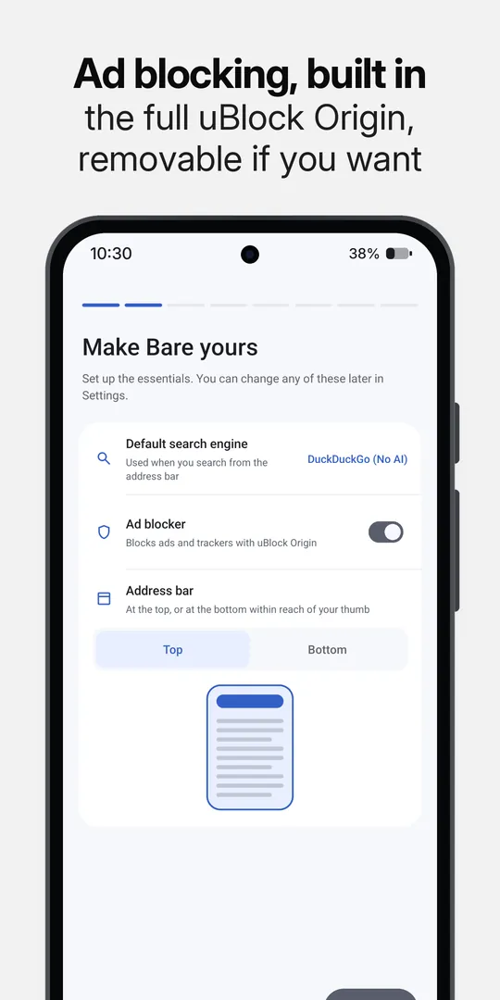
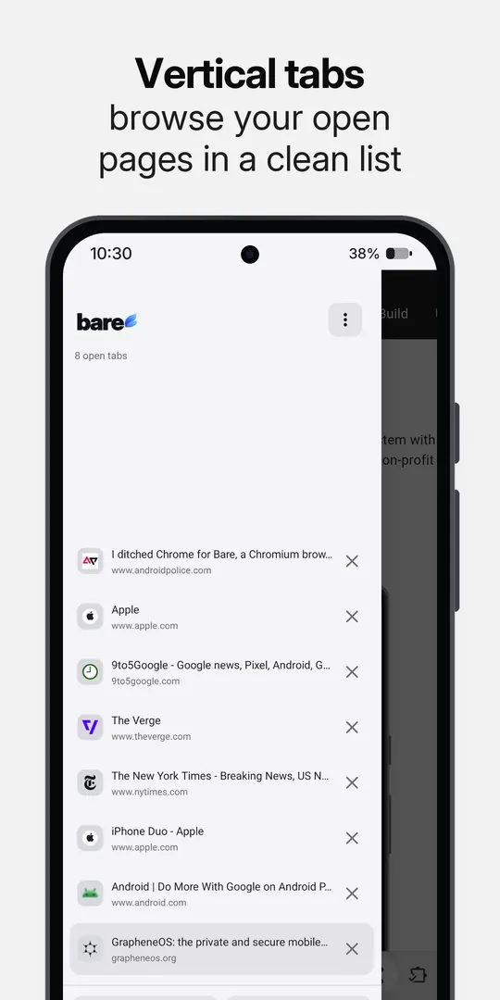
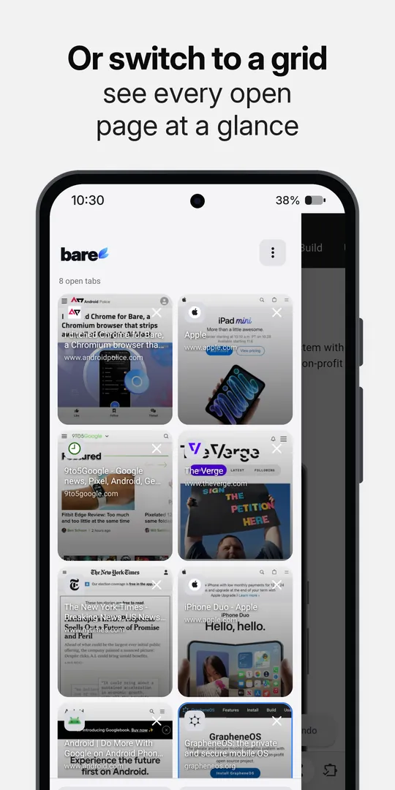
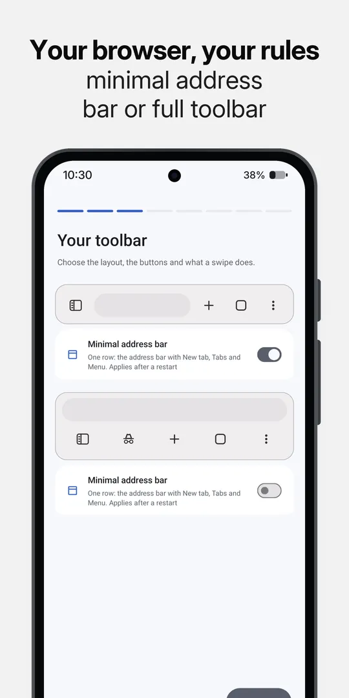
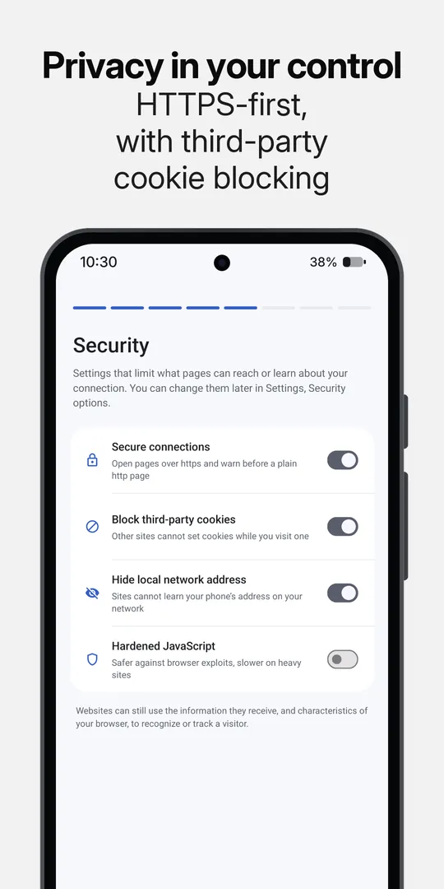

<h1> Bare Browser </h1>

[Website](https://barebrowser.org) · [Google Play](https://play.google.com/store/apps/details?id=org.barebrowser) · [Download APK](https://github.com/BareBrowser/bare-browser/releases/latest)

Bare removes Google sign-in, browser telemetry and AI features from Chromium. Desktop extensions
work, and uBlock Origin comes installed.

- Version: `2.0.0-beta.2`, a pre-release. versionCode `802000025` (arm64) and `802000020`
  (32-bit arm).
- Base: Chromium `156.0.8078.25` (commit `12282315`).
- Runs on: Android 10 or newer, on arm64 or 32-bit ARM. There is no x86 build.
- Size: 209 patches, 35,945 insertions and 2,898 deletions across 731 files.

## What you can do

- Install desktop extensions from the Chrome Web Store, a CRX file or an unpacked folder. Pin
  the ones you use to the toolbar.
- Use the full [uBlock Origin](https://github.com/gorhill/uBlock), included by default. You can
  disable or remove it.
- Put the address bar at the top or bottom, arrange the toolbar, and switch between list and grid
  views for tabs.
- Open your tabs in a drawer that slides in from the left, as page thumbnails or as a list. The
  regular tab switcher has the same grid or list choice.
- Set each button on the bottom bar, including Find in page, Search, Back, Forward and the tabs
  drawer. Swipe along the bottom bar or the address bar to switch tabs. A minimal address bar is a
  single row with New tab, Tabs and Menu, and you can hide items from the three dot menu.
- Find Settings grouped into Your Browser, Preferences & tools and Bare. Pick an app icon (Light,
  Dark or Retro), let the System theme use true black, and make pages fit the phone's width while
  keeping the user agent you chose.
- Manage extensions on a phone-sized page that shows each one's version and status, with switches
  for Enabled and Allow in Incognito, Install CRX, Load unpacked and Update all. Bare offers to
  install a `.crx` when it finishes downloading, and the Chrome Web Store is laid out as a phone
  list.
- Translate pages by sending their text to a LibreTranslate-compatible server that you enter,
  after you confirm. Google Translate is a separate choice and stays off until you turn it on.
- Lock Incognito with fingerprint or face only, wipe it after 1, 3 or 5 failed unlocks, and allow
  or block screenshots in it.
- Turn on security options: secure connections, third-party cookie blocking, hiding your local
  address in WebRTC and hardened JavaScript.
- Receive web push through a distributor app that you pick in Settings, instead of through Google.
- Keep supported video playing with the screen off. Save media from a page, or send downloads to
  another manager. The other app gets the page address and the User-Agent, and your cookies only if
  you allow it, never from Incognito. Long press a video that a page streams and choose Download
  video to fetch the file the page names.
- Choose your search engine. DuckDuckGo is the default; Google (No AI) is available, and you can
  add your own.

  
  
  
   
  
  
  

## Install

Bare runs on Android 10 or newer, on 64-bit and 32-bit ARM devices.

- [Get Bare on Google Play](https://play.google.com/store/apps/details?id=org.barebrowser) for
  updates through Play.
- [Download an APK from GitHub](https://github.com/BareBrowser/bare-browser/releases/latest)
  if you prefer to install it yourself. The release page lists the APK choices, checksums,
  changes and upgrade notes.

## For developers

This repository is a patch series against a pinned Chromium Desktop Android revision. The
`patches/` directory holds Bare's changes, numbered in the order they apply; [docs/patches.md](docs/patches.md) says how.

To build it yourself, start with [the build guide](docs/build-from-source.md). The
[builder notes](BUILDING.md) cover the container, versioning and signing.
[Reproducibility](docs/reproducibility.md) explains how to compare a local build with a release,
and [build constraints](docs/build-constraints.md) records the upstream limits.

## Network behaviour

Bare has no account or telemetry service of its own. It still makes some network requests:
Chromium updates security components and may provision Widevine through Google; uBlock Origin
fetches filter lists and extension updates. The GitHub APK checks for Bare releases if you enable
automatic updates. Google Play handles updates for the Play build.

Safe Browsing is unavailable in this build, so Bare does not show phishing or malware warnings.
See the [measured network behaviour](docs/network-behaviour.md) for the detailed capture and
[privacy policy](https://barebrowser.org/privacy) for how browsing data is handled.

## Credits

Bare is licensed under [BSD-3-Clause](LICENSE) and built on
[Chromium](https://www.chromium.org/). We also look at
[Titanium](https://github.com/jqssun/android-titanium-browser),
[Cromite](https://github.com/uazo/cromite) and
[ungoogled-chromium](https://github.com/ungoogled-software/ungoogled-chromium) when tracing
Chromium behaviour. Thanks to the developers who keep that work open.

[uBlock Origin](https://github.com/gorhill/uBlock) is by Raymond Hill and contributors. Bare
bundles the upstream signed extension without changing its source or repackaging it. It keeps
its own GPL-3.0 licence; see [NOTICE](NOTICE).

Chromium is a trademark of Google LLC. Bare is independent of Google and the Chromium project.

   
  <small>Made with ❤️ in San Francisco</small>

